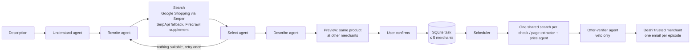

# Bargain Agent

An agentic AI system that finds products and monitors bargain prices across New Zealand retailers — 159.333 Computer Science Project, Massey University, Semester 2 2026.

## Team

| Role | Name | Email |
| :--- | :--- | :--- |
| Project Lead | Fengwei Zhang (24009491) | Zephyri.fw@gamil.com |
| Data Engineer | Gang Zhao (24009365) | 3132057704@qq.com |
| Interface Developer | Tianshuo Gao (24009350) | 3084083988@qq.com |
| Agent Dev & Test | Xiao Zhang (24009323) | 274751389@qq.com |
| Agent Dev & Test | Wenhan Zhang (24009400) | 3384155536@qq.com |

## How it works



- **Find** is a LangGraph pipeline of AI agents (`pipeline.py`, `agents/`). Search itself is code: Google Shopping (via Serper, with SerpApi as fallback) returns structured listings with prices, so retailer sites are not scraped. Firecrawl adds candidates only when Google returns too few, and their prices must be read from the page by the price-extractor agent.
- **Agents choose, code decides.** Agents may only pick server-assigned evidence ids; every model output is validated; budget/condition vetoes, deal thresholds, deduplication and send permits are deterministic. Every agent falls back to plain code when the model is unavailable.
- **Multi-merchant monitoring**: when you pick a product, matching finds the same product at other merchants (rules + AI verification, at most 5, trusted ones pre-selected). Each check runs one shared Google Shopping search (Serper; SerpApi as fallback/detail) and alerts on the cheapest trusted same-product offer. A pasted product URL is read through Scrape.do, Firecrawl or Tavily (fallback chain): a single JSON-LD product offer is used directly, otherwise the price-extractor agent reads the page and its price must appear on the page.
- **All merchants are shown; trusted merchants trigger alerts** (`TRUSTED_MERCHANTS`, `ALERT_TRUSTED_ONLY`). Second-hand offers are rejected unless requested, and the offer-verifier agent can veto wrong models and bundles.
- **Cost guards:** `SERPER_DAILY_MAX_CALLS`, `SERPAPI_DAILY_MAX_CALLS`, `FIND_MAX_QUERIES`, `MONITOR_MAX_SOURCES`, `MONITOR_MIN_FREQUENCY_MINUTES`.

The app never buys anything and does not claim the lowest price on the whole web. Shipping is not included in prices.

## Quick start (Windows, Python 3.13)

```powershell
py -3.13 -m venv venv
.\venv\Scripts\python.exe -m pip install -r requirements.txt
Copy-Item .env.example .env   # then fill in LLM, SERPER (and/or SERPAPI), SMTP and DEFAULT_NOTIFY_EMAIL
.\venv\Scripts\python.exe webapp.py --port 8765
```

Open http://127.0.0.1:8765/. Checks and continuous monitoring send **real** emails and ask for confirmation first.

### CLI

```powershell
.\venv\Scripts\python.exe main.py find "跑步用的无线耳机，300 纽币以内"
.\venv\Scripts\python.exe main.py add "Monitor https://shop.example.nz/p/123 below NZD 250 every day"
.\venv\Scripts\python.exe main.py list
.\venv\Scripts\python.exe main.py sources 1
.\venv\Scripts\python.exe main.py history 1
.\venv\Scripts\python.exe main.py modify 1 --target-price 220
.\venv\Scripts\python.exe main.py pause 1   # resume / stop
.\venv\Scripts\python.exe main.py check 1   # may send an email
.\venv\Scripts\python.exe main.py run       # scheduler loop
```

### Tests and evaluation (offline)

```powershell
.\venv\Scripts\python.exe -m unittest discover -s tests
.\venv\Scripts\python.exe -m evaluation          # replayed model answers
.\venv\Scripts\python.exe -m evaluation --live   # real model, costs calls
.\venv\Scripts\python.exe -m evaluation.collect_live   # real price sample: prints the plan; --run spends credits
```

## Project structure

```
pipeline.py        LangGraph Find pipeline (understand → rewrite → search → select → describe)
agents/            AI agents: understand, rewrite, select, describe, task_parser,
                   price_extractor, offer_verifier, deal_summary
llm.py             Single validated LLM entry point (call_json), per-agent model config
sources/           Providers behind protocols: serper, serpapi, scrapedo, firecrawl, tavily, registry
matching.py        Same product at other merchants, with hard limits
pricing.py         Source observation, quota guard, merchant trust, URL safety
scheduler.py       Checks, identity verdicts, deal decision, send permits, dedup
storage.py         SQLite schema (PRAGMA user_version) and persistence
notifier.py        SMTP email
webapp.py, static/ Local web UI (127.0.0.1, CSRF/Origin/Host guarded)
cli.py, main.py    Command line
schemas.py         Validation of task and price-extraction outputs
config.py          .env configuration
prompts/           Agent prompts
evaluation/        Price, instruction and notification accuracy
tests/             Offline test suite
archive/           Historical docs and one-off scripts
```

## Docs

- [Module interfaces](docs/INTERFACES.md)
- [System context](docs/SYSTEM_CONTEXT.md)
- [Evaluation](docs/EVALUATION.md)
- [Decisions](project_progress/DECISIONS.md) · [Known issues](project_progress/KNOWN_ISSUES.md)
- [Proposal](PROPOSAL.md)
