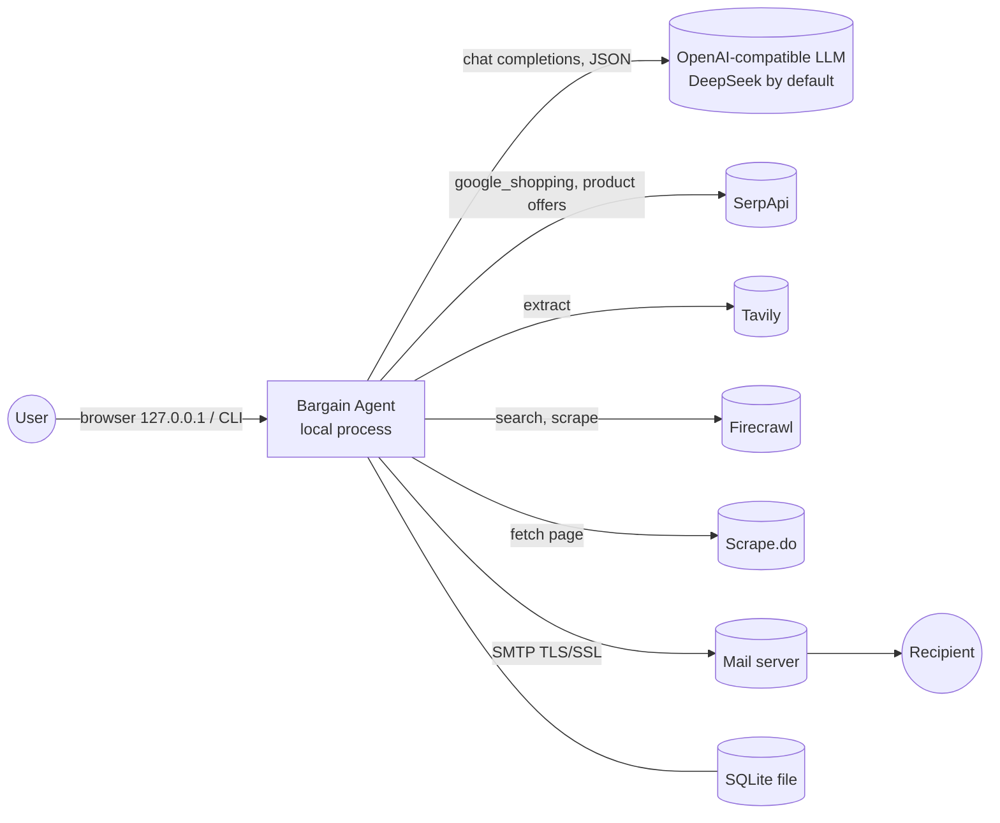

# System context

## Boundaries

| External system | What is sent | What comes back | Failure handling |
| --- | --- | --- | --- |
| LLM | prompt + structured input (descriptions, evidence summaries without links/tokens, page text) | JSON validated locally | retry once with the error, then deterministic fallback |
| SerpApi | search query / product id / page token, NZ locale, API key (query string) | listings and seller offers with prices | typed errors; daily local cap; never logged with the key |
| Tavily / Firecrawl / Scrape.do | one public product URL (screened by `is_safe_public_url`), Bearer key | page text or schema-validated price | next extractor in the chain; recorded as a source error |
| SMTP | one alert per deal episode | accepted / error | scheduler-owned attempt budget; permits prevent duplicates |

## Trust and safety rules

- The web server binds to 127.0.0.1 only and guards every POST with CSRF, Origin and Host checks.
- Model output is data: agents may only reference server-assigned ids; prices, thresholds and send decisions are code.
- Prices shown or compared come from SerpApi structured data or a validated page extraction, never from model prose.
- No purchases, no account actions, no CAPTCHA or access-control bypass. Providers fetch pages; a blocked page is a recorded failure.
- Monitoring runs only while the process runs; nothing is scheduled outside it.
